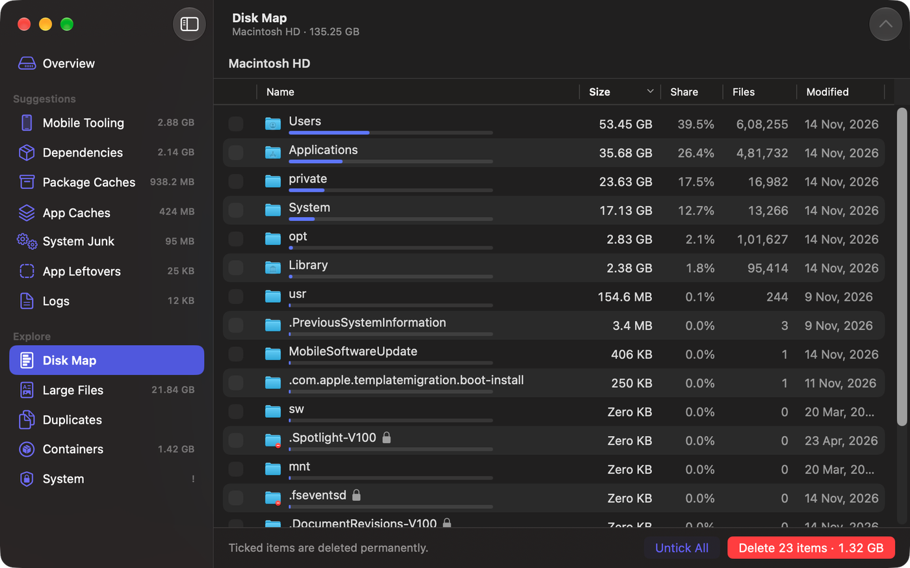

<p align="center">
  
</p>

<h1 align="center">Reclaim</h1>

<p align="center">
  A free, open-source Mac storage cleaner for developers.<br>
  <a href="https://github.com/kstmostofa/reclaim/releases/latest/download/Reclaim.dmg"><b>Download Reclaim.dmg</b></a> ·
  <a href="https://reclaim.mostofa.me">Website</a> ·
  <a href="https://reclaim.mostofa.me/docs">Docs</a>
</p>

<p align="center">
  
</p>

Developer Macs fill up quietly: `.next` and DerivedData folders, `node_modules` in every old project, Gradle and npm
caches, emulator images, Docker build cache. Reclaim scans the whole disk, explains what each of those is and what
happens if you delete it, and removes what you tick in one click.

## Features

- **Scans the whole disk** in about a minute, measuring the space files really use.
- **Knows developer junk:** build caches, dependencies, package-manager caches, app caches and logs, mobile tooling,
  leftovers of uninstalled apps. [Every rule](https://reclaim.mostofa.me/docs/what-it-finds).
- **Three safety levels:** Safe items rebuild themselves and are ticked for you; Rebuild and Personal items wait for
  your decision.
- **One-click delete** with no confirmation per file, or Move to Trash if you prefer. Protected folders can never be
  deleted.
- **Disk Map, Large Files and Duplicates**, with hard links and APFS clones handled correctly.
- **Docker and OrbStack** clean-up through Docker's own commands.
- **System junk** through an optional root helper that answers only to Reclaim.
- **Menu bar, schedules and low-space alerts.**
- **Private:** no account, no analytics, no network access.

## Install

Requires macOS 14 or later, on Apple silicon or Intel.

1. [Download Reclaim.dmg](https://github.com/kstmostofa/reclaim/releases/latest/download/Reclaim.dmg), open it and
   drag **Reclaim** onto Applications. No need to build anything. Optionally check it with
   `shasum -a 256 -c Reclaim.dmg.sha256` (from the [release page](https://github.com/kstmostofa/reclaim/releases/latest)).
2. Reclaim is not notarized, so macOS blocks it the first time. Open it once, then go to
   **System Settings › Privacy & Security** and click **Open Anyway**.
3. Give it **Full Disk Access** in **System Settings › Privacy & Security › Full Disk Access** so it can see the
   whole disk.

Full steps, including updating and uninstalling, are in the [install guide](https://reclaim.mostofa.me/docs/install).

## Build from source

You need Xcode and [XcodeGen](https://github.com/yonaskolb/XcodeGen).

```sh
brew install xcodegen
git clone https://github.com/kstmostofa/reclaim.git
cd reclaim
xcodegen generate
open Reclaim.xcodeproj
```

- `Packages/ReclaimCore`: the scanner, rules, deleter, duplicate finder, Docker client and helper policy, with tests
  (`swift test`). Tests only create and delete files in temporary folders.
- `App/`: the SwiftUI app. `Helper/`: the root helper.
- `website/`: the website and docs (Next.js and Fumadocs), exported to `docs/` for GitHub Pages.
- `brand/`: scripts that draw the icons.
- `scripts/release.sh`: builds and signs a release as a disk image and a zip.

## License

MIT, see [LICENSE](LICENSE). The website shows renderings of Apple's SF Symbols and macOS pointer, which are not
covered by the MIT License; see [NOTICE](NOTICE).
